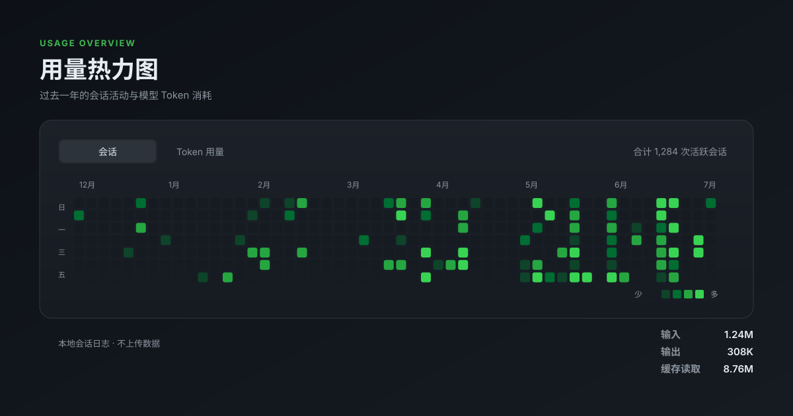

<div align="center">

# the coding assistant Usage Heatmap

[中文](README.md) · **English**

</div>



A [the coding assistant / DSH](https://github.com/) plugin. Click the green grid icon in the left sidebar to open the Usage Heatmap panel, which shows daily session activity and model token usage.

## Features

- **Usage stats**: token usage for today, last 7 / 15 / 30 days; today additionally breaks down into input, output and cache-read (three stacked rows, labels left-aligned, values right-aligned).
- **Heatmap**: 5 levels of daily activity intensity; switch between the "Sessions / Token usage" tabs, with ranges of the last 3/6/12/18/24 months or this year.
- **Hover**: shows the date and that day's value. **Click a cell**: lists the session IDs and timestamps with activity that day.
- Auto-refreshes every 15 seconds by default; manual "Refresh" is also available.
- Theme follows the host light/dark setting; all visible text goes through the Client locale (Chinese / English).
- **Deleting a conversation never shrinks history**: each session's daily aggregate is archived, so the heatmap does not fade after a delete (see "Delete archive" below).

## Installation

> 💡 Hover over a code block and click the copy button in its top-right corner to copy the whole instruction, then paste it into a DSH conversation. Full source / tarball / update steps: [INSTALL.md](INSTALL.md) ([中文](安装说明.md)).

**Option 1 · Repository URL (easiest)**

```
Install with plugin_manager install_bundle: https://github.com/yingguan-Cloud/dsh-usage-heatmap
```

**Option 2 · Release tgz (download it, then replace the path)**

```
Install with plugin_manager install_bundle: C:\path\to\dsh-usage-heatmap-1.1.0.tgz
```

**Option 3 · Local clone (prefix with `link:` to follow repo updates)**

```
Install with plugin_manager install_bundle: link:C:\path\to\dsh-usage-heatmap
```

Restart DSH and hard-refresh (Cmd/Ctrl+Shift+R). A green grid icon in the left sidebar means success.

> The only dependency, `@deepseek-ai/schemastery`, is fetched from the public npm registry automatically — no bundled `node_modules` needed.

## Data semantics

- **Sessions**: a Session counts once on its creation day and on each day with its own events; derived child sessions count separately.
- **Tokens**: from assistant messages in session logs, usage of failed attempts, and compaction-summary usage — summing the four buckets input, output, cache-read and cache-write. `reasoning` is already included in output and is not double-counted. Fork-inherited history is counted only in the parent.
- The panel's token total always equals the sum of the four buckets (a test guards this).
- **No monetary Credits**: the current Harness session API has no verifiable billing field, so the second tab is explicitly "Token usage" — no made-up Token→Credits exchange rate.
- No session content, tool calls, or event copies are stored — only local daily aggregates; no external services are contacted.

## Delete archive (since v1.1)

The heatmap writes **each session's daily aggregate** to `usage-heatmap-state.json` in the current profile directory — only session id, creation time, and per-day session/token counts, **never any content or events**. Therefore:

- After a conversation is deleted (including `dsh-delete-session`'s "Delete"), the days already archived **never decrease**.
- A session is snapshotted synchronously on `session/disposed` right before it is torn down, so even a live session that was never opened in the heatmap before deletion still counts.
- About 2.5 seconds after load, the plugin sweeps every **persisted but non-live** session in the background, closing the gap where an old conversation is deleted before it was ever seen.
- The archive is merged again after a restart. It is **append-only**: what is protected is a delete *after* it was archived; a session already deleted before this version first ran (its log is gone) cannot be resurrected.
- Start over: quit DSH and delete `usage-heatmap-state.json`. Set `keepDeleted: false` to disable archiving entirely and return to counting only currently existing sessions.

## Configuration (the `usage-heatmap` row in `cordis.patch.yml`)

`defaultMetric: sessions|tokens`, `rangeMonths: 1..24`, `weekStart: 0|1`, `scale: quantile|fixed`, `backfill: true|false`, `timeZone` (default `Asia/Shanghai`).

Archive options: `keepDeleted: true|false` (default `true`), `stateFile` (empty by default = `usage-heatmap-state.json` in the current profile directory; set an absolute path to relocate it).

## Agent tool

`usage_report`: returns the session count, the four token buckets plus total for a range (defaults to the current month), and token usage for today, the last 7, 15 and 30 days. It shares the same aggregation code (`readDaily`) as the panel, so the two always agree — both include archived data from deleted sessions.

## API

The page calls the same-origin `GET /api/dsh-usage-heatmap?from=YYYY-MM-DD&to=YYYY-MM-DD[&day=YYYY-MM-DD]`. The route is registered on the shared `/api` channel via `ctx.connection.fetch.register`, using the same browser-cookie access control; unauthenticated requests get 401.

The response includes `archived`: the number of sessions that are archived but no longer present in the current session list — a quick self-check that archiving works.

## Local verification

```sh
node --test test/rollup.test.js test/archive.test.js   # 13 tests: aggregation, archive, no shrink after delete, keepDeleted=false
node --check index.js && node --check store.js && node --check client.js && node --check rollup.js
```

## License

[MIT](LICENSE)
