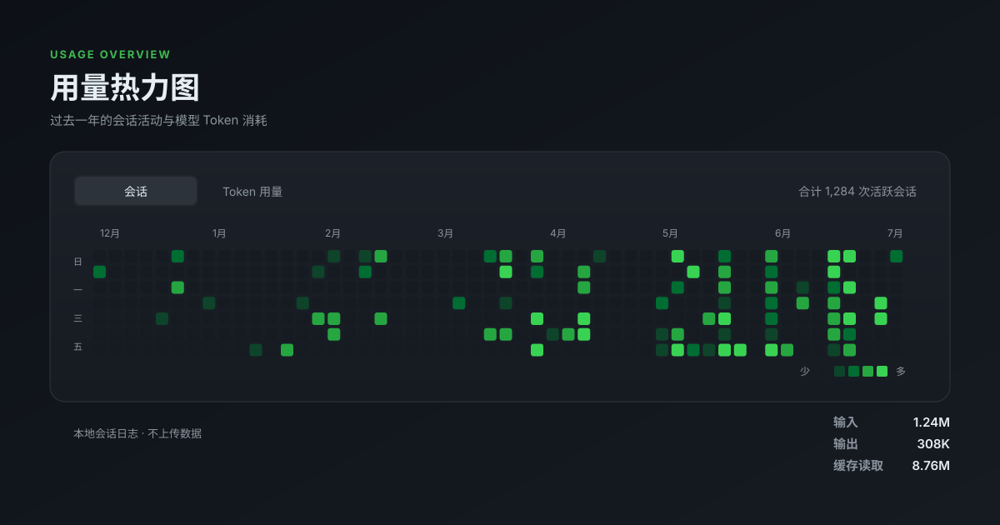

<div align="center">

# the coding assistant 用量热力图

**中文** · [English](README.en.md)

</div>



一个 [the coding assistant / DSH](https://github.com/) 插件：在左侧栏点击绿色方块图标打开「用量热力图」面板，按日展示会话活动强度与模型 Token 消耗。

## 功能

- **用量统计**：今天、近 7 天、近 15 天、近 30 天的 Token 消耗；今天额外展示输入、输出、缓存读取分项（三行排列，标签左对齐、数值右对齐）。
- **热力图**：按日活跃强度，深浅绿 5 级；可在「会话 / Token 用量」两个标签间切换，范围可选最近 3/6/12/18/24 个月或今年。
- **悬停**：显示日期与当天数值。**点击某格**：列出当天有活动的会话 ID 与时间。
- 默认每 15 秒自动刷新；也可手动「刷新」。
- 主题随宿主明暗切换，所有可见文案走 Client locale（中/英）。
- **删除对话不回退统计**：每个会话的按日聚合会归档，删除后历史热力图不变淡（详见下文「删除归档」）。

## 安装

> 💡 鼠标移到代码块上点右上角复制按钮即可一键复制整条指令，粘贴到 DSH 对话发送。完整的源码安装 / tarball 安装 / 更新步骤见 [安装说明.md](安装说明.md)（[English](INSTALL.md)）。

**方式一 · 仓库地址（最省事）**

```
用 plugin_manager 的 install_bundle 安装：https://github.com/yingguan-Cloud/dsh-usage-heatmap
```

**方式二 · Release tgz（下载后把路径换成实际路径）**

```
用 plugin_manager 的 install_bundle 安装：C:\path\to\dsh-usage-heatmap-1.1.0.tgz
```

**方式三 · 本地克隆目录（路径前加 `link:` 可跟随仓库更新）**

```
用 plugin_manager 的 install_bundle 安装：link:C:\path\to\dsh-usage-heatmap
```

安装后重启 DSH 并硬刷新（Cmd/Ctrl+Shift+R），左侧栏出现绿色方块图标即成功。

> 唯一依赖 `@deepseek-ai/schemastery` 会从公共 npm 源自动获取，无需自带 `node_modules`。

## 数据口径

- **会话**：一个 Session 在创建日及每个有自有事件的活动日各计一次；派生的子会话单独计数。
- **Token**：来自会话日志中的助手消息、失败尝试的 usage 以及压缩摘要 usage，合计输入、输出、缓存读取、缓存写入四项。`reasoning` 已含在输出中，不重复加总。分叉继承的历史只在父会话计一次。
- 面板上的 Token 总量恒等于四项之和（有测试守住这一条）。
- **不提供货币 Credits**：当前 Harness 的会话接口没有可核实的计费金额字段，所以第二个标签明确叫 Token 用量，不做 Token→Credits 的汇率臆造。
- 不保存会话正文、工具调用或事件副本，只保留按日聚合；不连接任何外部服务。

## 删除归档（v1.1 起）

热力图会把**每个会话的按日聚合**写入当前 profile 目录下的 `usage-heatmap-state.json`，只含会话 ID、创建时间和每日的会话数/四项 Token 数，**不含任何正文或事件**。此后：

- 会话被删除（包括 `dsh-delete-session` 的「删除对话」）后，已归档的那几天**不会减少**。
- 会话在卸载/删除前会通过 `session/disposed` 事件再做一次**同步快照**，所以即使删除前从未打开过热力图的活动会话也会被计入。
- 插件加载约 2.5 秒后会在后台补扫一次所有**持久化但非活动**的会话，避免「旧会话还没被看过就被删掉」的缺口。
- 重启后归档仍会合并进统计。归档**只增不减**：受保护的是「归档之后」的删除；若某会话在本版本首次运行前就已被删（日志已不在），无法凭空恢复。
- 清零重来：退出 DSH 后删除 `usage-heatmap-state.json`。把 `keepDeleted` 设为 `false` 可完全关闭归档，行为回到只统计当前存在的会话。

## 配置（`cordis.patch.yml` 的 `usage-heatmap` 行）

`defaultMetric: sessions|tokens`、`rangeMonths: 1..24`、`weekStart: 0|1`、`scale: quantile|fixed`、`backfill: true|false`、`timeZone`（默认 `Asia/Shanghai`）。

归档相关：`keepDeleted: true|false`（默认 `true`）、`stateFile`（默认留空 = 当前 profile 目录下的 `usage-heatmap-state.json`，可写绝对路径改位置）。

## Agent 工具

`usage_report`：返回区间内（默认本月）的会话数、四项 Token 分项与总量，以及今天、近 7 天、近 15 天、近 30 天的 Token 消耗。它和面板共用同一套聚合代码（`readDaily`），所以两边数字必然一致，也都包含已删除会话的归档数据。

## 接口

页面调用同源 `GET /api/dsh-usage-heatmap?from=YYYY-MM-DD&to=YYYY-MM-DD[&day=YYYY-MM-DD]`。该路由通过 `ctx.connection.fetch.register` 注册在 `/api` 的共享通道上，与浏览器登录 Cookie 使用同一套准入；未认证请求返回 401。

返回里的 `archived` 是「已归档、但当前会话列表中已不存在」的会话数量，便于自查归档是否生效。

## 本地验证

```sh
node --test test/rollup.test.js test/archive.test.js   # 13 项：聚合、归档、删除后不回退、keepDeleted=false
node --check index.js && node --check store.js && node --check client.js && node --check rollup.js
```

## License

[MIT](LICENSE)
